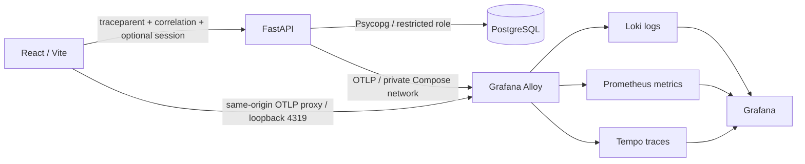

# Happy Wallet Bank — Grafana observability POC

`grafana-poc` demonstrates safe, correlated observability from a React browser
journey through FastAPI business logic to PostgreSQL. Happy Wallet is a local,
synthetic banking application for learning—not a real bank or production platform.
Use synthetic customers/accounts only.

## Read the project in this order

1. This walkthrough: purpose, architecture, startup and acceptance status.
2. [React implementation](banking-web/README.md).
3. [FastAPI implementation](banking-api/README.md).
4. [Database model and setup](docs/database/README.md).
5. [Observability tutorial](docs/observability/README.md).

Detailed procedures live in `docs/runbooks`. The
[documentation inventory](docs/runbooks/documentation-inventory.md) records where
historical information was retained.

## What the POC demonstrates

Users log in, inspect accounts/profile/transactions and make internal synthetic
transfers. Ownership checks, account locking, atomic debit/credit writes, stored
rejections and idempotent retries remain the banking application's responsibility.

Manual browser instrumentation emits journey spans, safe event logs and timings.
FastAPI provides technical/business spans; Psycopg supplies database spans. Both
SDKs export through Alloy to Loki, Prometheus and Tempo. Source-controlled Grafana
dashboards provide customer-experience, investigation and engineering views.



Stack: React, TypeScript, Vite, Material UI, React Router, Python 3.12, FastAPI,
Psycopg, PostgreSQL 17, OpenTelemetry, Alloy, Loki, Prometheus, Tempo and Grafana.
The services run in Docker; Vite serves the browser application on the host.

## Repository structure

```text
banking-web/                 React pages, API client, browser telemetry/tests
banking-api/                 FastAPI modules, migrations, synthetic seeds/tests
alloy/                      Shared three-signal OTLP routing
prometheus/                 Metrics configuration
tempo/                      Local trace storage and receivers
grafana/                    Datasource/provider configuration and dashboard JSON
docs/database/              PostgreSQL guide
docs/observability/         Observability tutorial
docs/runbooks/              Validation, acceptance and historical records
compose.yaml                Base services and persistent volumes
compose.observability.yaml  Additive telemetry configuration
```

`banking-api-backup-step15` and `banking-api-before-step16` are historical source
snapshots, not active services. Compose builds only `banking-api`.

## Identity, correlation and privacy

| Context | Meaning |
| --- | --- |
| JWT | Existing authentication credential; never telemetry |
| Session ID | Observability UUID after login; restored on reload, cleared on logout; never authorization |
| Correlation ID | One login attempt or transfer journey; shared across stages/retries; validated by FastAPI |
| Trace ID | OTel distributed trace identity; frontend CLIENT spans parent FastAPI spans through W3C `traceparent` |

Metrics contain only bounded route/outcome/category labels. Context IDs remain in
approved log/trace attributes. Telemetry excludes credentials, customer/account/
recipient details, amounts, payment IDs, idempotency keys, bodies, SQL text/parameters
and raw exceptions. Do not share secrets, banking payloads or HAR recordings.

## Quick start

Prerequisites: Docker Desktop/Compose, Node.js compatible with the checked-in
Vite version, npm, available loopback ports and local `.secrets` files. Host Python
is optional for administrative scripts. For a fresh lab, follow
[database setup](docs/database/README.md) before login; Compose does not apply SQL
migrations/seeds automatically. Preserve an existing lab's data and passwords.

From the repository root in PowerShell:

```powershell
docker compose -f compose.yaml -f compose.observability.yaml config --quiet
docker compose -f compose.yaml -f compose.observability.yaml up -d --build
docker compose -f compose.yaml -f compose.observability.yaml ps
Invoke-RestMethod http://localhost:8000/health
cd banking-web
npm ci
npm run dev -- --host 127.0.0.1 --port 5173 --strictPort
```

Stop this project's Vite process before `npm ci` on Windows to avoid a native-module
file lock. Open **localhost**, not `127.0.0.1`, in the browser: existing API CORS
permits `http://localhost:5173`.

| URL | Purpose |
| --- | --- |
| <http://localhost:5173> | Banking UI |
| <http://localhost:8000/docs> | API documentation |
| <http://localhost:8000/health> | Process health, not DB readiness |
| <http://localhost:3000> | Grafana with existing local credentials |
| <http://localhost:9090> | Prometheus |
| <http://localhost:3100/ready> | Loki readiness; browse logs in Grafana |
| <http://localhost:3200/ready> | Tempo readiness; browse traces in Grafana |
| <http://localhost:12345> | Alloy component UI |

## Validate and investigate

Start with [automated validation](docs/runbooks/automated-validation.md): frontend
unit/build/lint checks and isolated backend telemetry tests. The existing live
SDK integration test checks propagation/export without a banking write.

Then use [manual E2E validation](docs/runbooks/manual-e2e-validation.md) to log in,
perform one synthetic transfer and inspect its browser → FastAPI → business → DB
trace, related logs, metrics and Grafana panels. A successful transfer changes lab
balances. Never reset/reseed the database to undo a test.

Grafana's **Banking | Observability** folder contains three primary dashboards:
**Happy Wallet | Customer Experience**, **Journey Investigation**, **API Health**.
The original **Banking API | Observability** dashboard remains as a legacy view.
Empty correlation searches deliberately return no correlated results.

## Completion status and limits

Instrumentation and provisioned dashboards are implemented. Current automated
results and final manual stage statuses are recorded in the runbooks. A documented
plan is not a passed E2E test: unconfirmed stages remain NOT TESTED.

UI automation is intentionally excluded. This phase does not redesign banking,
change schema or introduce cloud/Kubernetes deployment. Production security,
version pinning, distributed login throttling, HTTPS/proxies, retention and load
testing remain outside this local POC. Never use `docker compose down -v` to fix
an application or telemetry issue.
