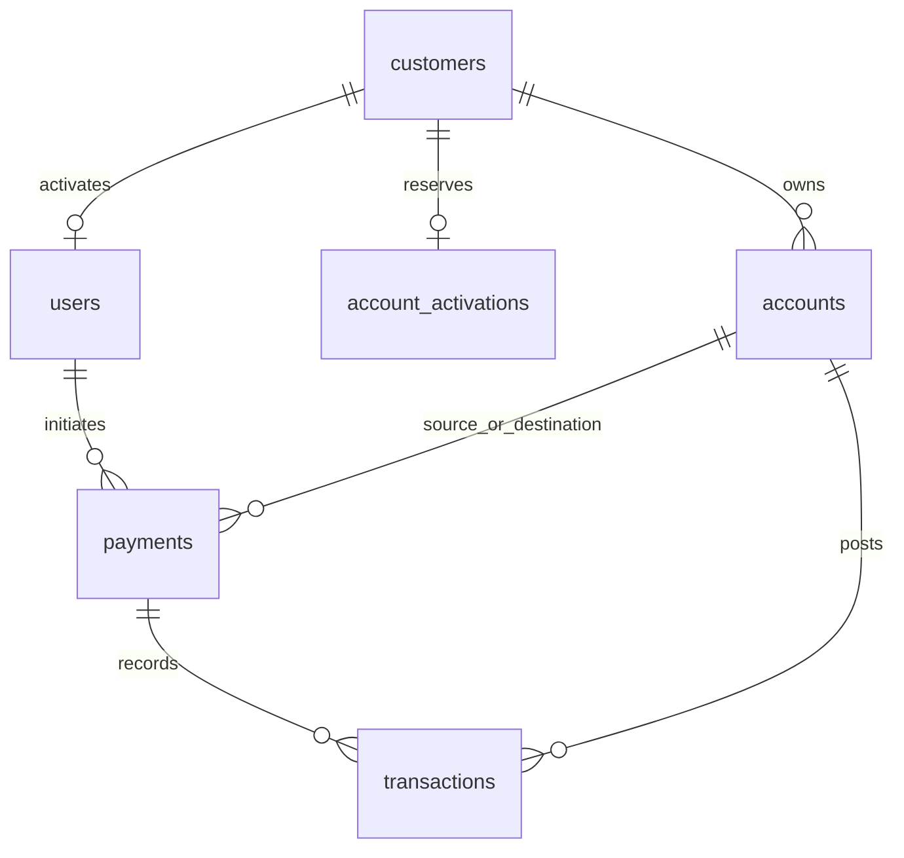

# PostgreSQL synthetic banking model

PostgreSQL stores the synthetic identities, accounts and atomic payment ledger.
The persistent `postgres-data` volume is the lab's data of record. See the
[API guide](../../banking-api/README.md) for endpoint behavior and
[historical rollout record](../runbooks/poc-rollout-history.md) for earlier setup.

## Schema and relationships

| Table | Purpose and key relationships |
| --- | --- |
| `schema_migrations` | Applied/baselined SQL versions |
| `customers` | Synthetic profile; parent of accounts, users and activations |
| `users` | One username/Argon2 password hash per activated customer |
| `account_activations` | Reserved username, token hash, expiry and consumed timestamp |
| `accounts` | Owned active USD checking/savings accounts; nonnegative decimal balance |
| `payments` | Initiating user, source/destination, amount, outcome and scoped idempotency key |
| `transactions` | Payment-linked debit/credit entries with account references |



Amounts are `NUMERIC(18,2)`, never binary floating-point in the payment API. Source
and destination must differ. A payment is `completed` with no error code or
`rejected` with an error code. `(initiated_by_user_id, idempotency_key)` is unique;
`(payment_id, entry_type)` prevents duplicate debit/credit entries.

The seed defines three synthetic customers and six accounts. Existing balances
and payment/transaction counts change through legitimate lab testing; do not
compare them with an obsolete historical fixed baseline or reseed to restore it.

## Migrations and initial setup

The repository does not have an automatic bootstrap/migration runner. Files are
explicit administrative SQL, and some intentionally stop if already applied:

| File in `banking-api/migrations` | Effect |
| --- | --- |
| `000_tracking.sql` | Migration tracking table |
| `001_identity.sql` | Customer/user identity tables |
| `002_banking_schema.sql` | Banking tables, constraints, indexes, restricted grants and version record |
| `003_account_activation.sql` | Activation table and version record |
| `004_activation_permissions.sql` | Column-limited activation permissions and version record |

**Existing lab:** inspect `schema_migrations` first. Do not replay CREATE TABLE
files or seed against populated tables. No schema changes are needed for the
observability POC.

**Fresh lab only:**

1. Create the three local `.secrets` files without committing their values:
   `postgres_password.txt`, `banking_app_password.txt`, `jwt_secret.txt`. Use
   interactive secure input for passwords and a random JWT signing key of at least
   32 characters. Never overwrite an existing lab's secret files; the PostgreSQL
   initialization password file does not rotate an existing database password.
   The historical guide retains the original local secret-generation procedure.
2. Start PostgreSQL with `docker compose up -d postgres` and check its health.
3. Connect locally as `banking_admin`, create `banking_app LOGIN` if this is a new
   database, and set its password interactively using psql `\password banking_app`.
   Use the same private value as `banking_app_password.txt`; do not put it in SQL
   files or command-line arguments. Never recreate a role in an existing lab.
4. Apply `000_tracking.sql`, then `001_identity.sql`, one administrative transaction
   per file. Identity migration 001 does **not** insert its own version: record
   `('001', 'Customer identity', 'applied')` in `schema_migrations` after successful
   creation, before 002. Use `baselined` only when intentionally recording an
   already-existing verified identity schema.
5. Apply 002, 003, 004 in order with stop-on-error and single-transaction execution.
   They validate predecessors and record themselves. For a reviewed fresh file:

   ```powershell
   Get-Content -Raw banking-api/migrations/002_banking_schema.sql |
     docker compose exec -T postgres psql -U banking_admin -d banking_lab -v ON_ERROR_STOP=1 --single-transaction
   ```

6. Review/apply `banking-api/seed/001_master_data.sql` once on its intended empty
   tables. Its guards do not justify reseeding a running lab.
7. Run `seed/generate_activation.py` locally with a synthetic username. It uses the
   administrative secret and emits a private one-time, 30-minute activation token.
   Activate through `/api/v1/auth/activate`, supplying a private password. Do not
   capture/share token output or store credentials in documentation.

Administrative host Python needs Psycopg; the API itself runs inside Docker.
Complete grants/setup before protected API calls. A healthy container alone does
not prove the tables/role have been initialized.

## Restricted role and payments

The app can read necessary identity/banking data, update only account `balance`,
and insert payments/transactions. Activation grants permit the required user
columns and only `used_at` updates. It cannot administer schema or manage profiles.

Psycopg's connection context controls commit/rollback. A transaction advisory
lock serializes a user's idempotency key; the unique constraint is a second guard.
Identical replay returns stored content; changed content conflicts. Account rows
are locked in sorted UUID order to reduce deadlock risk and prevent overlapping
transfers from racing the balance check.

A fresh success writes payment, debit, credit and balance updates in one commit.
Insufficient funds stores a rejected payment but writes no balances/ledger entries;
the endpoint returns 409 after the commit. Technical exceptions roll back. The
telemetry commit span observes the existing boundary without changing it.

## Read-only checks

These queries expose aggregates/configuration, not customer/account records:

```sql
SELECT version, description, status FROM public.schema_migrations ORDER BY version;
SELECT (SELECT count(*) FROM public.customers) AS customers,
       (SELECT count(*) FROM public.accounts) AS accounts,
       (SELECT count(*) FROM public.payments) AS payments,
       (SELECT count(*) FROM public.transactions) AS ledger_entries,
       (SELECT sum(balance) FROM public.accounts) AS total_balance;
SELECT status, count(*) FROM public.payments GROUP BY status;
SELECT has_table_privilege('banking_app', 'public.accounts', 'SELECT') AS account_read,
       has_column_privilege('banking_app', 'public.accounts', 'balance', 'UPDATE') AS balance_write;
```

Record a baseline before a test and compare intentional deltas afterwards. A
transfer changes two balances but preserves their combined value. Retain backups
using the operator's existing process; a source-code snapshot is not a DB backup.
Never drop/recreate/reset the database or delete Docker volumes to resolve telemetry.
