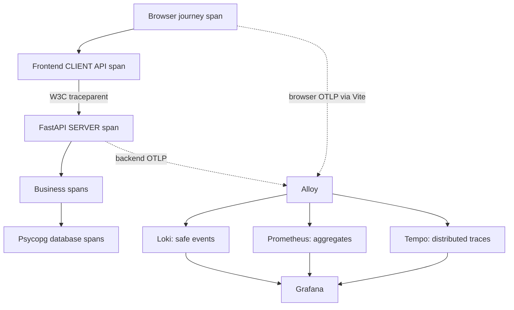

# End-to-end observability tutorial

This POC combines manual browser instrumentation with existing FastAPI/Psycopg
instrumentation. Read the [React](../../banking-web/README.md),
[API](../../banking-api/README.md) and [database](../database/README.md) guides for
their business behavior. Validation commands live in [runbooks](../runbooks/automated-validation.md).

## Two related flows

Requests propagate context through React → FastAPI → business spans → Psycopg/
PostgreSQL. PostgreSQL does not independently export application OTLP; Psycopg
creates the technical DB spans in the API process.

## Context lifecycle

The JWT authenticates; it is never an observability attribute. An opaque session
UUID is created after authentication, restored on reload and cleared at logout.
Login attempts have independent correlation UUIDs. Transfer source selection
starts a correlation/root span reused across verification, review, submission,
result and uncertain retries. A new source/type starts a new journey.

The shared client creates an API child and sends `X-Correlation-ID`, optional
`X-Session-ID` and `traceparent`. W3C context contains version, trace ID, parent
span ID and flags. FastAPI extracts it, so server/business/DB spans share the trace
and preserve real parent-child relationships. Correlation IDs can group retries;
they are not trace IDs, auth credentials or financial idempotency keys.

Backend ContextVars validate bounded IDs and isolate requests. Starlette ordering
establishes context before telemetry reads it. Session context is currently stored
on the backend but not added to its exported attribute allowlist.

## Signals and their meanings

Frontend service `happy-wallet-web` emits `browser.login`, `browser.transfer`,
`browser.api.request`, `browser.navigation`, `browser.javascript.error`. Explicit
contexts avoid async/global contamination. Page timing is commit-to-next-frame,
not full page readiness/Web Vitals. Error capture excludes messages and stacks.

Backend service `synthetic-banking-api` emits server/DB spans and business spans:
`login.authenticate`, `recipient.verify`, `payment.process`, account/balance
validation, persistence and commit. Existing Psycopg instrumentation supplies SQL
operation spans; raw SQL/parameters are removed before export. Stored rejected
payments are business failures. Replays count HTTP attempts but not another
successful financial execution.

| Signal/event | Searchable fields |
| --- | --- |
| Backend `api_request_completed` | `correlation_id`, `trace_id`, `http_route`, `http_method`, `http_status`, `duration_ms` |
| Backend `business_operation_failed` | IDs above, `journey_type`, `journey_stage`, `outcome`, `failure_category` |
| Frontend journey/failure events | Approved correlation/trace/session IDs, `journey_type`, `journey_stage`, `outcome`, `failure_category` |
| Frontend `javascript_error` | `trace_id`, optional session, safe error kind/category; no message/stack |

Dots in OTel log keys become underscores in Loki structured metadata:
`journey.type` → `journey_type`, `failure.category` → `failure_category`.
Query-result `stream` maps can merge metadata with labels; use Loki's label API
to verify actual indexing, not a result row's keys.
These identifiers are not Loki indexed labels or Prometheus labels. Business
failure logs do not have HTTP fields; investigation joins backend records by trace
ID, never only correlation ID. Frontend API durations are in spans/histograms,
not invented per-request Loki fields.

Backend metrics cover API/payment HTTP requests, login attempts/outcomes, transfer
attempts/executions and recipient failures, with API/login/payment histograms.
Frontend metrics cover journey events, API/navigation duration and JS errors.
Bounded labels use safe routes/types/stages where recorded, outcomes and failure
categories. No entity/context IDs, usernames, amounts or keys become metric labels.

Frontend failures are event counts: one retried transfer can fail and later
complete. Do not derive financial success rates by combining these with execution
counters. Missing outcome series means no observed series, not a measured zero.
Browser metrics currently use cumulative temporality and a shared static resource.
Concurrent tabs/producers can collide in the same series; these POC panels are not
an exact multi-user/session accounting system. Use one browser for final acceptance
and backend counters for financial executions. This limitation does not justify
adding session IDs as metric labels or changing collector routing in this phase.
`increase` needs multiple samples and may extrapolate; histogram windows without
samples produce gaps. Unique/active sessions are intentionally not calculated
from high-cardinality identifiers.

## Alloy and storage

Both SDKs use Alloy's same OTLP HTTP receiver. FastAPI reaches `alloy:4318` inside
Compose. Vite's same-origin `/otel/v1/{traces,metrics,logs}` proxy reaches loopback
4319; the browser is not given Docker network access or collector credentials.
Separate batch processors/exporters route:

- Logs → Loki's `/otlp` base endpoint.
- Metrics → Prometheus `/api/v1/otlp/v1/metrics`; the overlay enables its receiver.
- Traces → Tempo's internal OTLP HTTP receiver on 4318.

Prometheus's self-scrape is not how application metrics arrive. Loki stores safe
event bodies with structured metadata. Tempo stores the span tree on local volume.
Frontend and backend require no second observability backend or routing pipeline.

## Grafana provisioning and investigation

Datasource/provider YAML files are named `banking-api-observability.yaml`.
Stable UIDs `step16-prom`, `step16-loki`, `step16-tempo` preserve links; they are
opaque historical identifiers, not visible Step16 names. The provider targets
**Banking | Observability**, UID `bfyyz4nf7mmtcb`, and preserves unrelated dashboards.
JSON lives in `grafana/dashboards` and is mounted/provisioned automatically.

| Dashboard | Purpose |
| --- | --- |
| Happy Wallet \| Customer Experience | Browser starts/completions/failure events, API quantiles, navigation P95, JS errors, safe failure breakdown/logs |
| Happy Wallet \| Journey Investigation | Exact correlation search, frontend stages, backend HTTP metadata, both-service logs and distributed trace |
| Happy Wallet \| API Health | Backend rates, safe zero-traffic 5xx percentage, freshness, histograms, business outcomes, PostgreSQL latency and slow traces |
| Banking API \| Observability | Retained original/legacy backend view |

Empty correlation input returns no correlated logs/traces. Operational recent-failure
panels remain independent of the textbox. Request fields/table joins are bounded;
narrow time ranges to avoid missing completion rows. IDs do not filter Prometheus
panels. Inspect the frontend API child in Tempo for its individual duration.

Loki's derived field matches structured `trace_id`, then opens Tempo. Tempo's
reverse custom query filters that trace across **both services**, with ±1 minute
around the selected span. Select the browser root/widen time range to include a
long journey's earliest event. Legacy datasource UID links remain valid.

## Privacy, limitations and troubleshooting

Backend export uses a strict span allowlist and a single dedicated safe logger;
frontend fields are constructed explicitly without automatic DOM/HTTP/console
capture. Passwords, JWTs, usernames, profiles, account/recipient data, amounts,
payment IDs, idempotency keys, bodies, SQL and raw exception text are excluded.
Alloy routing does not replace these SDK privacy boundaries. Inspect only telemetry
payloads/attributes locally; never save HARs or share banking payloads.

Dev frontend export defaults on; production needs `VITE_OTEL_ENABLED=true` at build
and a same-origin proxy. Delivery on page close is best-effort. No session replay,
Web Vitals, browser automation, alerts, public collector or production deployment
is included. Versions/retention/auth/rate-limit production decisions remain open.

For empty panels, check time range, service selectors, export intervals (backend
10s/frontend 15s metrics), missing-series behavior and telemetry freshness. Verify
Alloy readiness/config and storage endpoints before changing SDK logic. If links
are missing, choose the provisioned sources and expand `trace_id` metadata. Do not
reset the DB or delete unrelated Grafana objects to resolve a telemetry problem.

Use [Grafana procedures](../runbooks/grafana-observability-validation.md),
[business scenarios](../runbooks/business-observability-validation.md),
[frontend procedures](../runbooks/react-observability-validation.md), and the
[manual final acceptance record](../runbooks/manual-e2e-validation.md).
